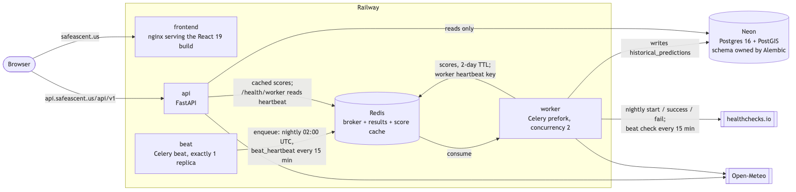

# Deployment

**Stack:** Railway (hosting, one Redis) + Neon (Postgres 16 + PostGIS) + Porkbun (DNS) + healthchecks.io (alerts).

Production is Railway only. `docker-compose.yml` is for local development and mirrors the Railway services (same images and start commands); CI's `guards` job fails if the two drift.



## Services

One repo; each Railway service builds from its own root directory and config file.

| Role | Railway service | Config | Start command | Notes |
|---|---|---|---|---|
| API | `backend` | `backend/railway.toml` | `uvicorn app.main:app --host 0.0.0.0 --port 8000` (Dockerfile default) | Healthcheck `/health`. Worker liveness is `/health/worker`, deliberately not the Railway healthcheck, so a worker outage doesn't take the API down |
| Worker | `celery-worker` | `backend/railway-worker.toml` | `celery -A app.celery_app worker --loglevel=info --concurrency=2 -E` | One replica. Runs the scores heartbeat and the beat heartbeat task |
| Beat | `beat` (**owner creates it**) | `backend/railway-beat.toml` | `celery -A app.celery_app beat --loglevel=info --schedule=/tmp/celerybeat-schedule` | Exactly one replica; a second double-schedules every task |
| Catalog cycle | `catalog-cycle` (**owner creates it**) | `backend/railway-catalog-cycle.toml` | `python -m app.pipelines.catalog_cycle run` | Cron `0 9 2 1 *` (UTC), built from `backend/Dockerfile.jobs`. Auto-deploy off; deployed by hand after merges that touch `app/pipelines`. See Scheduled jobs |
| Frontend | `frontend` | `frontend/railway.toml` | nginx serving the Vite build | Healthcheck `/health`. `MAINTENANCE_MODE` build arg, see below |
| Redis | Railway Redis | — | — | Celery broker, result backend, and score cache |

The API, worker, and beat all build from `backend/Dockerfile` (Python 3.12, uv, non-root). `catalog-cycle` builds from `backend/Dockerfile.jobs`: the same image plus the `pipelines` dependency group (h3, rasterio, timezonefinder), which the API image leaves out. The frontend builds from `frontend/Dockerfile` (Node 22 build, nginx serve).

Domains: `safeascent.us` (frontend), `www.safeascent.us` (301 to the apex), `api.safeascent.us` (API). TLS is Railway's automatic certificates.

**The worker change and the beat service ship together.** The worker no longer runs an embedded beat. If the new worker deploys without a running `beat` service, nothing schedules the scores heartbeat or the beat heartbeat.

Worker notes for the relaunch:
- `--concurrency=2` (owner decision, kept for compose parity): a slow task cannot starve `beat_heartbeat`. Check the worker's memory with two prefork slots against the Railway plan's memory limit.
- `SKIP_WEATHER_STATISTICS` must be off (unset or `false`) on the worker at relaunch (owner decision).

## Environment variables

`.env.example` is the full list, kept in parity with `app.config.Settings` plus the frontend build args (`tests/test_env_example_parity.py`). Production specifics:

- `DATABASE_URL` on `backend`, `celery-worker`, and `beat`. The target is the least-privilege `app` role. Until the relaunch gate the services still use the owner role; switching them is the first relaunch step (plan Task 26).
- `REDIS_URL` (or the per-purpose `CACHE_REDIS_URL` / `CELERY_BROKER_URL` / `CELERY_RESULT_BACKEND`, which fall back to it).
- `ENVIRONMENT` unset or `production`. `ENABLE_ADMIN_ROUTES` off except for a deliberate admin session. `CORS_ORIGINS` unset (defaults to the production origins).
- `HEALTHCHECKS_SCORES_URL`, `HEALTHCHECKS_NIGHTLY_URL` and `HEALTHCHECKS_BEAT_URL` on the worker (the scores heartbeat pings the first two; the beat heartbeat the third). An unset URL skips the ping with a WARNING.
- `INGEST_DATABASE_URL` on `catalog-cycle` **only**: the `ingest` role on Neon's **direct** host (not the `-pooler` host; every ingest job, `catalog_cycle` included, refuses it), with verify-full TLS (`app.db.ssl` builds the verifying context; `ingest_engine` refuses a URL whose `ssl`/`sslmode` asks for anything weaker). Never set it on `backend`, `celery-worker`, `beat` or `frontend`. Set it as a Railway variable (with `--skip-deploys`), never in a file.
- `DATABASE_URL` on `catalog-cycle` is the inert placeholder `postgresql+asyncpg://unused@invalid.invalid/unused`, never a reference to `INGEST_DATABASE_URL` or any real database: `Settings` requires the field, the job never uses it, and a code path that wrongly reads it fails instead of connecting as `ingest` (fail closed).
- `HEALTHCHECKS_CATALOG_URL` (optional) on `catalog-cycle`: `/start`, then success only for an `ok` cycle, `/fail` otherwise.
- Frontend build args: `VITE_API_BASE_URL` (the API's `/api/v1` URL), `VITE_MAPBOX_TOKEN` (public token), `MAINTENANCE_MODE`.
- `MIGRATOR_DATABASE_URL` is set on **no** service. It lives only in the owner's gitignored `backend/.env.migrator`, for the explicit migration step.

## Trainer (Phase 3)

- `TRAINER_DATABASE_URL` (the `trainer` role) lives only in the owner's gitignored `backend/.env.trainer` on the Mac. Training, promotion and rollback run from there through the runbook.
- It is never a Railway service variable and never a GitHub Actions secret (pre-flight F48, 2026-10-22): the repo is public, and no workflow holds a production credential.
- Neon's **direct** host with verify-full TLS, as for ingest: `app.ml.db.trainer_engine` refuses an unset URL, the `-pooler.` host, and any `ssl`/`sslmode` weaker than verify-full, and never puts the URL in an error message.
- `HEALTHCHECKS_TRAIN_URL` (35-day dead-man check for the monthly training) goes in `backend/.env.trainer` too. `HEALTHCHECKS_SCORES_URL` is the daily stored-score heartbeat.

## Phase 3 roles

Training runs only from the owner's Mac (pre-flight F48); nothing here becomes a GitHub secret or Railway variable. All commands run from `backend/` after `. scripts/runbook_helpers.sh`, with `TARGET_HOST` set explicitly (a Neon branch host, or `production`). Rehearse on a fresh branch of production first; prod follows only after `gate_pass p3_0_branch`. The helpers are `MIG` (alembic as `migrator`), `OWNER_PSQL` (psql as the owner), `save_once`, `gate_pass` and `gate_require`; there is no `$OWNER_URL` or `$MIGRATOR_URL`. Agents never read `.env.trainer` or print any password.

Owner steps, in order, on the target. Each runs in its own subshell from `backend/`, so a failed step cannot leak a half-loaded environment into the shell:

1. `( . scripts/runbook_helpers.sh && export TARGET_HOST=<target> && OWNER_PSQL -f db/owner/schema_model_phase3.sql )` creates schema `model` (owned by `migrator`).
2. `uv run python -m scripts.write_role_url --role trainer --env-file .env.trainer --generate-password` writes `TRAINER_DATABASE_URL` and `TRAINER_PASSWORD` into `.env.trainer` (0600, never printed). It needs the owner URL: run it as `( set -a; . ./.env.owner; set +a; uv run python -m scripts.write_role_url ... )` so `.env.owner` is sourced inside the subshell and nothing is echoed.
   - **On prod, skip this step** when the rehearsal ran on a Neon branch of the same project: roles are shared across a project's branches, so the rehearsal's `trainer` password is already the prod one, and `.env.trainer` stays as it is. Regenerating would write a password that does not match the existing role. Only if the rehearsal ran somewhere else (a different project or a local database), delete `.env.trainer` deliberately and regenerate it, because the old password then belongs to a role that is not prod's.
3. `( set -a; . ./.env.trainer; set +a; . scripts/runbook_helpers.sh; export TARGET_HOST=<target>; OWNER_PSQL -f db/roles/trainer_login_phase3.sql )` gives `trainer` LOGIN with `CONNECTION LIMIT 4`. The password reaches psql through `\getenv`, never argv. It refuses a rerun. Login scripts run with `psql -X`, never `-L`, which would write the statement text to a log file. (`OWNER_PSQL` already passes `-X`; do not add `-L`.)

Then the migration and grants (agent or owner), as one subshell that stops at the first failure:

```bash
( cd backend && . scripts/runbook_helpers.sh && : "${TARGET_HOST:?export TARGET_HOST first (branch host or production)}"
  MIG upgrade 0012_model_registry || exit 1
  save_once ../data/review/p3-0/current-after.txt MIG current || exit 1
  OWNER_PSQL -f db/roles/grants_phase3.sql || exit 1
  OWNER_PSQL -f db/roles/verify_roles_phase3.sql || exit 1
  OWNER_PSQL -f db/roles/verify_roles_phase2.sql || exit 1
  gate_pass p3_0_branch )
```

`grants_phase3.sql` does `SET ROLE migrator`, which the owner holds. A failed verify row stops the run and nothing reaches prod. Rerun `grants_phase3.sql` then `verify_roles_phase3.sql` after every Phase 3 migration. A block that does not end with `GATE OK: ...` means STOP.

### PR 3-0 runbook

Rehearsal on branch `p3-0-rehearsal` (a fresh branch of production):

```bash
( cd backend && . scripts/runbook_helpers.sh
  TARGET_HOST="$(branch_host p3-0-rehearsal)" || exit 1; export TARGET_HOST
  save_once ../data/review/p3-0/heads.txt uv run alembic heads || exit 1          # expect 0012_model_registry (head)
  save_once ../data/review/p3-0/current-before.txt MIG current || exit 1 )         # expect 0011_exposure_index
```

STOP. The owner runs owner steps 1-3 above on the branch, then the migration-and-grants block (with `TARGET_HOST` exported as the branch host) ends in `gate_pass p3_0_branch`.

Prod, only after the owner's go. The owner first creates Neon branch `pre-p3-0` from `production` as the snapshot, then runs owner steps 1 and 3 on prod (step 2 per the note above). Then:

```bash
( cd backend && . scripts/runbook_helpers.sh && export TARGET_HOST=production
  gate_require p3_0_branch || exit 1
  MIG upgrade 0012_model_registry || exit 1
  save_once ../data/review/p3-0/current-prod-after.txt MIG current || exit 1
  OWNER_PSQL -f db/roles/grants_phase3.sql || exit 1
  OWNER_PSQL -f db/roles/verify_roles_phase3.sql || exit 1
  OWNER_PSQL -f db/roles/verify_roles_phase2.sql || exit 1
  gate_pass p3_0_prod )
```

The owner then keeps `TRAINER_DATABASE_URL` (direct host, `ssl=verify-full`) in `backend/.env.trainer` only, and creates the healthchecks.io check `train` (period 35 days, grace 3 days), adding its URL as `HEALTHCHECKS_TRAIN_URL` to `.env.trainer`. This runbook has not been executed.

## Database, roles, and migrations

- Alembic owns the schema (`backend/alembic/`). Revisions: `0001_baseline` (replays a sanitized schema-only dump; prod was **stamped** at it, never upgraded through it), `0002_drop_ascents_climbers`, `0003_hist_insufficient_data`, `0004_phase2a_foundation`. Treat every revision as forward-only.
- Every migration is an explicit owner step with `MIGRATOR_DATABASE_URL`, never at app startup and never from a Railway pre-deploy hook:
  1. Rehearse on a Neon branch: `uv run alembic upgrade head`, then `uv run alembic check`, from `backend/` with `MIGRATOR_DATABASE_URL` pointing at the branch.
  2. Apply to prod the same way from the owner's machine.
- Roles are created **only** with SQL run as the owner: `backend/db/roles/create_roles.sql`, then `backend/db/roles/verify_roles.sql` (prints `ALL ROLE CHECKS PASSED`). Never with neonctl, the Neon Console, or the Neon API; those grant `neon_superuser`.
  - `migrator` owns the schema objects and is the only app-side role with DDL rights. The owner role keeps DDL for the stamp and role steps, and inherits `migrator` (`WITH SET TRUE, INHERIT TRUE`) until the relaunch gate revokes that membership.
  - `app` has `SELECT` on the tables and still holds write grants on `historical_predictions` from the retired kernel nightly; no code writes it now (`tests/test_backtest_window_kept.py`).
  - `analyst` is pre-existing and read-only: `SELECT` via default privileges, no DML or DDL. It must already exist before `create_roles.sql` runs (the script grants it default privileges and `verify_roles.sql` checks it).
  - Role passwords are generated into the gitignored 0600 env files (from `backend/`: `python -m scripts.write_role_url --role <r> --env-file .env.<r> --generate-password`). `create_roles.sql` reads them as plaintext from `MIGRATOR_PASSWORD`/`APP_PASSWORD` via psql `\getenv` (never argv) and sends them over `verify-full` TLS; the server stores SCRAM-SHA-256. Neon rejects pre-hashed verifiers ("Neon only supports being given plaintext passwords", 2026-09-28), so the script refuses a value that looks like a SCRAM or md5 verifier, and anything under 32 characters.
  - `create_roles.sql` also revokes the running owner's default table grants to `analyst` in `public` (prod's `neondb_owner` had one). After `alembic stamp` and `alembic upgrade head`, `REVOKE ALL ON public.alembic_version FROM app`: the stamp creates that table under `migrator`'s default `SELECT` grant to `app`.
  - Role URLs (`migrator`, `app`) connect with full certificate and hostname verification (asyncpg `ssl=verify-full`), not just encryption: `app/db/ssl.py` builds the SSLContext from certifi's CA bundle (the `python:3.12-slim` image has no `ca-certificates` package, and asyncpg's own verify-full has no OS-trust fallback), applied only for a non-local host so `docker-compose.yml`'s TLS-less local/CI Postgres is unaffected.
- The step-by-step role and stamp procedure, including how credentials are generated and kept out of terminals and chat, is the owner runbook in `docs/superpowers/plans/2026-09-27-phase1b-foundations-pr5-8.md` (Task 8; relaunch steps in Task 26). This file does not repeat it.
- Phase 2 roles and schema: `create_roles_phase2.sql` (owner, once), migrations as `migrator`, then `grants_phase2.sql` and `verify_roles_phase2.sql` after each Phase 2 migration. Runbook: `docs/superpowers/plans/2026-09-28-phase2a-foundations.md` Tasks 8–10. Owner/analyst `psql` URLs always use `sslmode=verify-full&sslrootcert=system`.
- **Migrate before deploy** (owner decision 2026-09-29). Apply a migration to prod before any deploy of code that depends on it. `0004_phase2a_foundation`: the `Accident` model maps its 21 new columns and `/predict` selects them, so a deploy of the Phase 2a foundations merge before `0004` is on prod breaks `/predict` with `UndefinedColumnError`. **Before merging that PR**, confirm auto-deploy is off on every Railway service, and pause it if it is on: with auto-deploy on, the merge itself deploys. Deploys of `main` then stay off until the runbook's Task 9 Step 4 has succeeded (pre-merge gate at the top of Task 8). The old code ignores the added columns, so migrating first is always safe.
- MP tick-aggregate reloads only add new months (owner decision 2026-10-02): `internal.mp_tick_aggregates` is INSERT-only, and a stored `(mp_route_id, period, style)` row is never touched by a later scrape, matching count or not — a changed count (e.g. MP's ever-growing `total`) is skipped, not quarantined, and never counts toward `--max-quarantine-share`. This replaces the earlier known limitation where a later-scrape reload was likely rejected whole because most stored totals came back `count_changed`.
- `0008_mp_catalog` needs the `ltree` extension, which `migrator` cannot create (no `CREATE` on the database): before upgrading a branch or prod to it, the owner runs `backend/db/owner/extensions_mp_catalog.sql` with `psql`, then after the migration `grants_phase2.sql` and `verify_roles_phase2.sql` as for every Phase 2 migration. Its downgrade refuses while `canonical_routes`, `canonical_areas` or `internal.route_tick_scrapes` holds any row.
- MP catalog: run `uv run python -m app.pipelines.mp_catalog refresh` (as `ingest`, from `backend/`; `--dry-run` prints the counts and writes nothing) after every private MP scrape load, so `canonical_routes`/`canonical_areas` cover every `mp_routes`/`mp_locations` row. The scrape loader must upsert MP rows, never delete them: the catalog's FKs (`ON DELETE RESTRICT`) refuse the delete. A refresh whose scorable count falls more than 3% below the stored catalog's is rejected (logged in `source_ingest_log`, source `mp_catalog`) and changes nothing; find out why the scrape lost type strings before re-running. The `catalog-cycle` cron service runs it yearly as the first step of its cycle (Scheduled jobs, below); after a scrape load, run that service on demand, or run the refresh and the data jobs below by hand.
- Data jobs, after each `mp_catalog refresh` (as `ingest`, from `backend/`; the same order the `catalog-cycle` service runs): `uv run python -m app.pipelines.static_features points` (one point per area that holds a scorable route), then `uv run python -m app.pipelines.static_features elevation` repeated until its output reports `"sampled": 0, "retry": 0` (a non-zero `retry` is a transient DEM read error on that batch, not a failure — rerun), then `uv run python -m app.pipelines.static_features epqs-check` (the EPQS gate; exit 1 means it failed: stop, do not rebuild routes), then `uv run python -m app.pipelines.static_features routes` to rebuild `route_static_features` (it refuses if `points` hasn't covered every scorable route yet). The gate runs before every routes rebuild, by hand or in the cycle (reconciled 2026-10-15; an earlier line here called `epqs-check` a one-off acceptance run). Every ingest job refuses Neon's `-pooler.` host: use the direct host. Climate normals for newly-registered grid buckets are **not** filled by this sequence — they fill the next time `era5_window run` executes inside a Professional window (see Open-Meteo, below) — and `scoring_unit_features.normals_status` reads `pending` for them until then, never a fabricated value.
- `weather` (legacy) is dropped by `0013_drop_legacy_weather`, the Phase 3 MVP-1 hard gate. It is a contract migration: the previously deployed nightly and `/predict` read the table, so it runs on prod only after PR 3-4 is deployed and the nightly has switched to the scores heartbeat, behind its own runbook gate (Task 26). A non-empty table is refused unless an `ok` `r6_verify` row in `source_ingest_log` meets the agreement thresholds (n > 100, r_tmax > 0.95, p99_gust < 60), and has no downgrade: rollback is the `pre-p3-4` Neon snapshot branch. No dump is committed.
- Relaunch caveat, Open-Meteo key: `app/services/weather_service.py` and `app/api/v1/mp_routes.py` still send `settings.OPEN_METEO_API_KEY` on live calls, outside `era5_window`'s Budget and spend log. Per owner OQ7 the live app reads weather history from our database, so the production runtime (`backend`, `celery-worker`, `beat`) must not carry the Professional key; it is exported only into the paid `era5_window run` shell.

## Open-Meteo

The archive API needs Professional (Standard excludes it; pricing read 2026-09-28, re-check before buying). One Professional month per year, started on or after 10 January: run `era5_window run --window-start <day> --max-units <cap>` on prod until it reports no chunks and no normals due, then downgrade to Standard (which the nightly forecast and its `past_days` stopgap need). Between windows no ERA5 call is made.

## Scores heartbeat

The kernel nightly is gone (P3 Task 23); scores are written by the monthly training run. At 02:00 UTC beat enqueues `app.tasks.scores_heartbeat.scores_heartbeat` (message expires after 1h). It computes nothing. It checks that exactly one registry version is active, that its bundle bytes match `bundle_sha256`, and that it has a `model.route_scores` row for the current UTC month for every scorable route. Healthy: it pings `HEALTHCHECKS_SCORES_URL` and `HEALTHCHECKS_NIGHTLY_URL` (kept so the old dead-man check stays meaningful). Otherwise it pings `/fail` on both, logs the reason, and returns it (`no_active_version`, `multiple_active_versions`, `bundle_missing`, `bundle_sha_mismatch`, `missing_scores` with the count). While only the kernel baseline row is active, it fails with `bundle_missing`: nothing is servable until the first model version is promoted.

`app.tasks.cache_warming` warms `safety:{version}:{route}:{month}` from the active version's stored rows; it is not scheduled.

Operator notes:

- A lost broker connection cancels the in-flight task (`worker_cancel_long_running_tasks_on_connection_loss`). With the Redis broker the unacked message comes back only after the 6h `visibility_timeout`; the heartbeat's 1h `expires` discards a late copy, counted as expired.
- Beat keeps its schedule state in `/tmp/celerybeat-schedule`, which is lost when the beat container restarts. A beat restart that straddles 02:00 UTC skips that day's heartbeat; the `safeascent-nightly` healthchecks alert catches it.

Revoked and expired tasks are logged at ERROR; expired ones are counted per task per UTC day. `GET /health/worker` reports the 7-day counts.

## Alerts and liveness

| Check | Pinged by | Period | Grace |
|---|---|---|---|
| `safeascent-nightly` | the scores heartbeat (success, fail); the check predates it | 24h | 4h |
| `safeascent-beat` | `beat_heartbeat`, scheduled by beat every 15 min and run on the worker | 15 min | 60 min |

The beat check proves both that beat scheduled the task and that the worker consumed it, so a dead consumer alerts within 75 minutes.

`GET /health/worker` returns 200 while the worker's Redis heartbeat is fresh (`WORKER_HEARTBEAT_TTL_SECONDS`, default 120s) and 503 when it is missing or Redis is unreachable. Caveat: the heartbeat proves the consumer loop is turning only under the prefork pool on the Redis broker, which is what the worker runs. With `-P gevent`/`eventlet`, or when the consume socket dies silently, the heartbeat can stay fresh; the `safeascent-beat` healthchecks.io check is what catches those.

## Scheduled jobs

`catalog-cycle` (owner decision DP6, 2026-10-13) is a Railway cron service: it starts on its schedule, runs `python -m app.pipelines.catalog_cycle run` once and exits; Railway skips a tick while a run is still active, and `restartPolicyType = "never"` means a failed run is reported, not retried.

- **Cadence:** yearly, 2 January 09:00 UTC (`0 9 2 1 *`). It runs before plan 3's January ERA5 window opens (on or after 10 January), so the window buys normals for the buckets the year's new routes added.
- **Order:** `mp_catalog` refresh, then `static_features` points, elevation (repeated until a round samples nothing, at most 20 rounds), the EPQS gate, then routes. The gate runs **before** routes, and a failed gate blocks the rebuild. The cycle stops early, without the gate or routes, at a rejected refresh, at a step that raises (routes refuses while any point is missing), and when the rounds run out with points still to sample. When the only points left are pending a transient 3DEP retry, the gate runs over the sampled points and, if it passes, routes are rebuilt with NULL elevation for the pending ones (missing, never 0); the run reports `incomplete` and pings `/fail`, so one flaky tile never leaves new scorable routes out of `route_static_features` for a year (revised 2026-10-15). `--skip-epqs` skips the gate, so that run rebuilds routes from elevations no gate has checked; it is for on-demand runs only, and the cron start command never passes it.
- **On demand:** run the service from the Railway dashboard, or locally from `backend/` as `ingest`: `uv run python -m app.pipelines.catalog_cycle run [--skip-epqs] [--max-rounds N]`. `--skip-epqs` skips the ~15-minute EPQS gate and rebuilds routes ungated (see Order).
- **Exit codes:** `0` ok; `1` rejected refresh, failed EPQS gate, a refused URL (pooler host or malformed; the URL is never printed), or a step that raised; `2` incomplete (the elevation rounds ran out, with no gate or routes; or a transient 3DEP outage left points pending, with routes rebuilt if the gate passed). On `2`, re-run the service on demand once 3DEP has recovered; the run resumes from the points still pending, then gates and rebuilds routes. The run prints one JSON line with every step's counts. Anything but `ok` (a refusal, a failure, an incomplete run) pings `/fail`.
- **Private data stays local.** The MP scraper and its loader never run on Railway; the cycle only reads the `mp_*` tables they filled.
- **Cost (estimate, 2026-10-13, not re-checked):** Railway bills a cron service only while it runs; a yearly run is a few cents, well under $1 a year with on-demand runs.

## Maintenance mode

The frontend image takes a `MAINTENANCE_MODE` build arg (Railway service variable on `frontend`).

- `MAINTENANCE_MODE=true`: every path returns `503` with `Retry-After: 3600` and `Cache-Control: no-store`, serving `frontend/maintenance/index.html`. `/health` still returns `200` for the Railway healthcheck.
- `MAINTENANCE_MODE=false` (default): the React app.
- Both modes redirect `www.safeascent.us` to `https://safeascent.us` with a 301.

To flip: set the variable on the `frontend` service and redeploy. Locally: `frontend/docker-tests/test_images.sh all` checks both modes.

## Deploy pipeline

- CI (`.github/workflows/ci.yml`) runs on every PR and every push to `main`. Jobs: `backend` (uv sync, ruff, mypy, pip-audit, pytest including the migration and role tests against a PostGIS service, image build), `frontend` (npm ci, lint, typecheck, npm audit, vitest, build, image tests), `guards` (`scripts/check_no_scrapers.py`, a check that `docker compose config --services` matches the Railway topology, and `scripts/check_compose_matches_railway.py` for the worker/beat start commands) and `ci-ok`.
- `ci-ok` is the one required check. It fails unless every other job succeeded. Keep its name stable, because Railway "Wait for CI" and branch protection both key on it.
- Railway builds its own images from GitHub `main`. "Wait for CI" (after owner setup — not yet enabled) will make a red commit on `main` never deploy. No image registry and no deploy token are involved.
- **Auto-deploy is OFF on every Railway service until the relaunch** (plan Task 26); until then every deploy is a manual owner action. Re-enable it only after all three hold: migration `0003` is applied to prod, the `beat` service exists, and "Wait for CI" is on.
- `main` branch protection (a PR and a green `ci-ok` required, admins included, force-pushes blocked) is after owner setup — not yet enabled.
- Scraper code (anything fetching and parsing HTML pages) is never committed (D9). The `guards` job enforces this.

## Insufficient-data rollout (2026-09-28)

1. Run `alembic upgrade head` (migration `0003_hist_insufficient_data`) before the new backend/worker code runs. (Historical note: the retired kernel nightly's history insert needed it.)
2. Deploy backend and frontend together (the frontend requires `data_status`).
3. The kernel nightly this rollout once triggered no longer exists; the stored-score API needs no warm-up.
